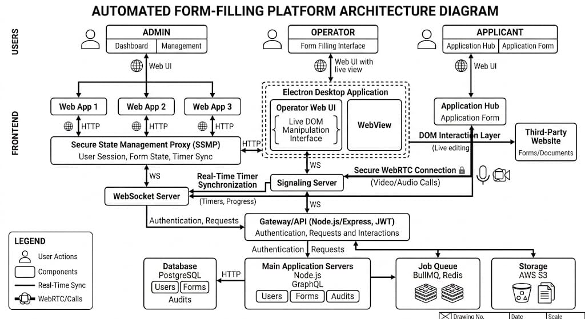

FORMFILLER

A full-stack web application for automated form filling, designed to simplify and streamline the process of completing digital forms.

---

Architecture Overview



The diagram above illustrates the overall system architecture of FormFiller, showing the interaction between the frontend client application and the backend server infrastructure.

---

Project Structure

```
FORMFILLER/
├── backend/               # Server-side application
│   ├── src/               # Backend source code
│   ├── package.json       # Backend dependencies and scripts
│   └── package-lock.json
├── frontend/              # Client-side application
│   ├── src/               # Frontend source code
│   ├── index.html         # Main entry point
│   ├── vite.config.js     # Vite build configuration
│   ├── tailwind.config.js # Tailwind CSS configuration
│   ├── postcss.config.js  # PostCSS configuration
│   ├── package.json       # Frontend dependencies and scripts
│   └── package-lock.json
├── .gitignore
├── README.md
└── IMG-20261014-WA0006.jpg  # Architecture diagram
```

---

Tech Stack

Layer Technology
Frontend Vite, Tailwind CSS
Backend Node.js
Styling Tailwind CSS
Build Tool Vite

---

Features

· Automated Form Filling — Intelligent form field detection and population
· Separated Architecture — Clean frontend/backend separation for maintainability
· Modern Frontend — Fast development with Vite hot module replacement
· Responsive Design — Utility-first styling with Tailwind CSS

---

Getting Started

Prerequisites

· Node.js (v18 or higher recommended)
· npm or yarn

Frontend Setup

```bash
cd frontend
npm install
npm run dev
```

Backend Setup

```bash
cd backend
npm install
npm start
```

---

Architecture Diagram

The complete architecture diagram is available in the repository root:


This diagram provides a visual representation of the system components, data flow, and interactions between the frontend and backend services.
